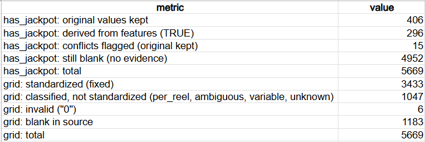
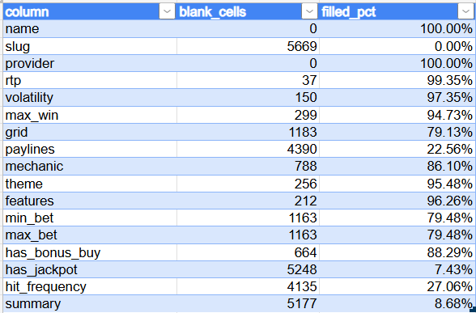

# Excel Data Quality Audit

An audit of a public catalog of 5,669 online slot games from 58 providers, built in Excel. The goal is to measure what is missing or wrong, complete only what written rules can support, and document every decision, before any analysis uses the data.

## Why this dataset

The dataset ships with its own quality claims: its documentation publishes a coverage percentage for each column. That turns the audit into a test with a known answer key, where the documentation can be checked against the data column by column. In two columns, it did not match.

It is also public and real (not synthetic), messy in useful ways (gaps, wrong types, free-text fields, contradictions between columns), and licensed for reuse with attribution. The subject of the data is incidental: the same checks apply to any product, customer or inventory catalog.

## Situation

A data catalog is only useful if its gaps and errors are known. Before analyzing this catalog, it was necessary to know which fields could be trusted.

## Task

Answer three questions:
1. Which columns are incomplete?
2. Which gaps can be filled safely, using a written and verifiable rule?
3. Which gaps cannot be filled without inventing data?

## Action

- **Measured gaps** in all 17 columns (`COUNTBLANK`) and compared them with the coverage published in the documentation.
- **Fixed a problem at the source:** opening the CSV directly in Excel converted 647 `grid` values such as `5-3` and `3-3-3` into dates, and broke special characters such as ™ and ∞. This was detected by checking the raw file in a text editor, and fixed by re-importing the data with automatic type conversion turned off.
- **Converted data types under control:** the clean import stores every value as text. Six numeric columns and two true/false columns were converted into new columns (`_num`, `_bool`), keeping the originals unchanged.
- **Filled missing `has_jackpot` values with a validated rule:** a blank value becomes TRUE only when `features` mentions a jackpot. The rule was tested against the rows where the answer was already known before being applied, and a blank with no evidence stays blank (never FALSE).
- **Standardized the free-text `grid` column** with a mapping table: each of its 204 distinct values was classified by type, and only formats with a single unambiguous form were rewritten.
- **Documented every change** in a cleaning log, and verified every number with independent counts in a `checks` sheet.

## Result

### Key findings

1. **The documentation does not match the data in two columns.** `slug` is documented at 100% coverage but is empty in all 5,669 rows. `has_bonus_buy` is documented at 36%, but 88.29% of rows are filled: the 36% matches the share of TRUE values (36.3%), so the documented "coverage" appears to count only games that have the feature.
2. **The tool can corrupt the data.** Excel's automatic conversion changed 647 values without any warning. After re-importing, no `grid` value is stored as a date, and all 17 gap counts match the first import.
3. **`has_jackpot` is 92.6% blank.** 296 blanks were filled from `features`. Among the 34 rows that had a known value and a jackpot mentioned in `features`, the two columns agreed in 19; the 15 contradictions (original FALSE while `features` lists a jackpot, 9 of them a "progressive jackpot") keep the original value and are flagged as `conflict`. 4,952 rows stay blank because there is no evidence either way.
4. **`grid` mixes many notations.** 3,433 rows were standardized as columns x rows. The rest were classified, not forced into one format: 166 per-reel layouts, 639 ambiguous values (a two-number hyphen notation such as `5-3` can mean 5x3 or two reels), 129 variable layouts, 113 unknown values (including self-contradicting entries such as `4x4 (2,401 ways)`), 6 invalid values (`0`) and 1,183 blanks.

### Gaps by column

### Cleaning log (summary)

| Step | Column | Rows affected | Check |
| --- | --- | --- | --- |
| Re-import without automatic type conversion | all columns | 647 | No `grid` value stored as a number; gap counts unchanged |
| Convert numeric columns | 6 `_num` columns | 22,827 | Numbers = total rows minus blanks, per column |
| Convert true/false columns | 2 `_bool` columns | 5,426 | TRUE + FALSE = filled values |
| Flag jackpot evidence in `features` | `jackpot_in_features` | 330 | 0 negations ("no jackpot"); 20-game manual review |
| Fill blank `has_jackpot` values | `has_jackpot_clean` | 296 | 296 + 19 + 15 = 330 |
| Record the origin of each value | `has_jackpot_source` | 15 conflicts | Categories add up to 5,669 |
| Classify `grid` formats | `grid_type` | 5,669 | Categories add up to 5,669 |
| Standardize fixed `grid` values | `grid_clean` | 3,433 | Filled cells = fixed rows |
| Mark invalid `grid` values | `grid_type`, `grid_clean` | 6 | 6 rows with `0` |
| Leave `slug` empty | `slug` | 0 | Documented only |

The full log, with each rule and its reason, is in the `cleaning_log` sheet.

## Workbook structure

| Sheet | Content |
| --- | --- |
| `data` | Original columns (unchanged) and the derived columns |
| `gaps` | Blank cells and fill rate for each column |
| `checks` | Independent counts that verify every result |
| `grid_formats` | Mapping table for the 204 distinct `grid` values |
| `cleaning_log` | Every change: rule, reason, rows affected and check |
| `summary` | Final state of the treated columns |

## Limitations

- The 15 jackpot conflicts cannot be resolved with this file alone: an external source would be needed to know which column is right.
- Values filled from `features` are evidence-based, not confirmed. Where both columns could be compared, they agreed in 19 of 34 cases (56%).
- Ambiguous `grid` values were kept as they are. Reading `5-3` as 5x3 is likely, but not provable from the data.
- The audit uses a snapshot of the dataset downloaded in October 2026.

## Applying this elsewhere

The same method works for any catalog, such as products in e-commerce, customer records in fintech or inventory in SaaS: check the documentation against the data, control data types at import, derive values only with written and validated rules, and classify what cannot be standardized instead of guessing.

## How AI was used

This project was AI-assisted and human-directed. I defined the audit questions, chose the dataset, and made every cleaning decision (what to fix at the source, what to derive, what to leave blank and why). I used an AI assistant to explain Excel functions, propose options, and draft parts of the documentation, which I reviewed and edited. Every result was verified against independent counts in the `checks` sheet, and that verification caught errors in AI-suggested formulas and ranges before they reached the final data.

## Tools

Excel for the web (tables, `COUNTBLANK`, `COUNTIF`, `COUNTIFS`, `IF`, `ISBLANK`, `SEARCH`, `ISNUMBER`, `VALUE`, `UNIQUE`, `XLOOKUP`, absolute references) and Google Sheets (import only).

## Files

- `slot-database.csv`: original source file, unchanged
- `excel-data-quality-audit.xlsx`: the audit workbook
- `images/`: screenshots used in this README

## Data source and license

Slot database published by [slot.report](https://slot.report) on [Hugging Face](https://huggingface.co/datasets/slreport/slot-database), licensed under [CC BY 4.0](https://creativecommons.org/licenses/by/4.0/). Data credit: slot.report.